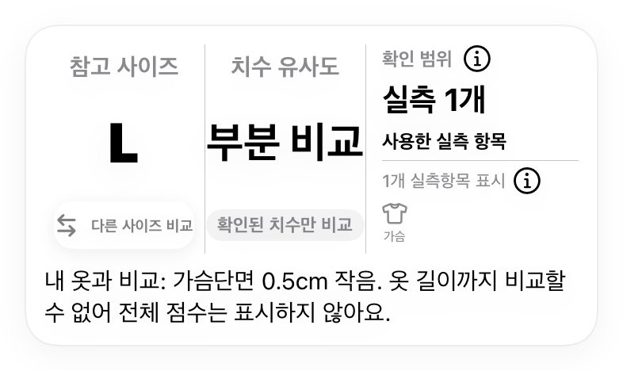
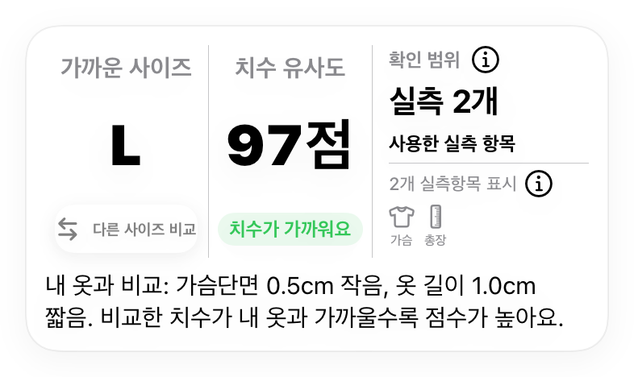

# FitMatch 치수 비교·사이즈 판단 재설계 — 2026-10-12

## 사용자 문제와 결정
첨부 실제 결과는 가슴 42.5/43.0cm 하나로 98%, 추천 L, '거의 완벽한 핏'을 표시했다. 산술 98은 단일 치수 차이의 점수이며 옷 전체 적합성의 확률이 아니다. 이번 사용자 지시는 기존 정책·결과 표현의 변경과 알고리즘 구현을 포함한다. 최신 main 2d01ea4 기반 feature/size-decision-20261012에서 구현한다.

결과는 (1) 확인된 차이, (2) 같은 항목으로 정렬한 사이즈 후보, (3) 전체 치수를 말할 만큼 근거가 있는지의 세 판단으로 나눈다. API·원본·서버 승인·사용자 선택 identity는 그대로 유지한다.

## 선택한 방식과 배제한 방식
- 채택: 검증된 실측만 계산하고 핵심 부위 충족 여부로 종합 점수 표시를 결정한다. 정보가 적어도 확인된 차이와 참고 후보는 제공한다.
- 배제: 가슴 하나의 98을 임의로 60으로 깎기. 모르는 치수를 작거나 다른 치수로 간주하면 결측과 실제 불일치가 섞인다.
- 배제: 다른 소매/앞뒤 길이를 추정 변환해 정답처럼 넣기. 현재 제공된 자료에는 이 변환 오차를 검증할 정답쌍이 없다.

## 판단 알고리즘
1. 기존 서버 승인 snapshot을 검증한다. 미승인·다른 상품/variant/size·다른 그룹은 계산 입력이 아니다.
2. 모든 승인 후보 사이즈의 공통 measurement code를 교집합으로 구한다. 동일 code의 단위/basis/가중치/기준옷 값도 동일해야 한다. 교집합이 없으면 자동 순위를 만들지 않는다.
3. 후보별 공통 항목으로 s_i=round(clamp(100-5*abs(target-reference),0,100)), S=round(sum(w_i*s_i)/sum(w_i)). 이 식은 기존 치수 차이 지수이며 착용 성공 확률이 아니다. 최적 계수로 검증됐다고 주장하지 않는다.
4. S 내림차순, 가중 절대차 오름차순, exact size UUID 순으로 정렬한다. 결측 항목이 많은 후보가 적은 항목만으로 유리해지지 않는다. 판매/재고 상태는 치수 순위를 바꾸지 않는다.
5. 종합 치수 점수 노출 조건:
   - 상의/아우터: 가슴과 몸통 길이가 모두 확인됨.
   - 바지/스커트: 허리·엉덩이·길이가 모두 확인됨.
   - 원피스: 가슴·길이와 허리 또는 엉덩이 중 하나가 확인됨.
   - 이너웨어/홈웨어: A–G만으로 상하/구성품을 확정할 수 없는 경우 부분 비교로 유지. 향후 명시적인 구조별 규칙 없이 추정하지 않는다.
   - unknown/legacy 무근거: 종합 점수 없음.
6. 핵심 부위 미충족이면 종합 점수 null, '참고 사이즈', '부분 비교', 확인된 cm 차이, 부족한 부위를 표시한다. 충분하면 '가까운 사이즈', '치수 유사도 N점'. '완벽한 핏', 퍼센트, 착용 성공 보장은 사용하지 않는다.
7. 모든 결과 화면·다른 사이즈·후보 목록·기록은 같은 판단 owner를 사용한다. 과거 완료 원본 수치와 순위는 재작성하지 않되, 현재 UI의 과장된 표현은 노출하지 않는다.

## 쇼핑몰별 비교
| 조합 | 사용 |
|---|---|
| 유니클로↔유니클로 | 같은 canonical/측정 기준의 가슴·어깨·길이, 등중심 소매는 같은 등중심끼리만 |
| 무신사↔무신사 | 검증된 같은 측정 기준의 실측. 판매 브랜드가 다양하므로 쇼핑몰 일치만으로 의미를 같게 간주하지 않음 |
| 자라↔자라 | 검증된 가슴·어깨·소매와 앞면 어깨봉제선→밑단 길이. 앞길이 canonical을 앱에 정확히 추가하고 서버 점수 정책을 준비 |
| 서로 다른 쇼핑몰 | 서버가 동일 code/unit/basis로 승인한 항목만. 앞길이↔뒷길이, 등중심↔어깨 소매 혼합 금지 |

## 저장과 호환성
- 새 배치 점수 규칙은 engine v3. v1/v2 기록은 기존 산술로 재현한다.
- completion에 ranking_measurement_codes를 추가해 사용한 교집합을 고정한다. 원래 metric_evidence 전체도 보존한다.
- 서버는 snapshot으로부터 같은 교집합·점수·순위·coverage를 검증한다. 기존 auth/ownership/idempotency 검사 보존.
- 자라 앞길이 SQL은 전용 canonical front_length_shoulder_to_hem만 활성 정책에 추가한다. back_length나 HPS로 바꾸지 않는다.
- 운영·개발 DB 쓰기, QA/main 통합, 배포는 준비된 변경과 검증 증거 이후 별도 적용 단계다.

## 검증
실제 가슴 42.5/43.0 사례의 종합 점수 없음, 핵심 부위 충분한 동일 쇼핑몰, 다른 소매/길이 불일치, 후보별 결측으로 순위 왜곡 방지, 숫자/원본/identity 보존, v1/v2 History 재현, 신규 v3 저장·재조회, 위조 교집합·점수 거절을 확인한다. 화면은 실제 SwiftUI fixture로 검증하고 실제 계정 E2E와 구분한다.

## 구현한 세부 기준
- 새 계산 버전 `fitmatch-ios-vnext-snapshot-v3`: Decimal로 점수와 가중 평균을 계산한다. 동점 순위의 평균 차이는 소수 6자리로 반올림하여 Postgres numeric과 일치시킨다.
- 다른 후보에 없는 승인 치수도 버리지 않는다. `additionalItems` → `additionalMeasurements` snapshot에 보존하고 cm 차이를 표시한다. M의 길이는 10cm 길고 L의 길이는 없다면, M의 알려진 길이 차이를 숨기거나 모른다고 표시하지 않는다.
- 핵심 부위 충족은 공통 순위 항목으로 판단한다. 같은 부위의 측정값이 많아도 빠진 기장을 대신하지 못한다.
- 결과, 다른 사이즈, 옷장 후보, 기록 목록·그리드에 `SizeComparisonDecision`을 연결했다. 옛 기록의 저장 점수는 수정하지 않고 표시만 제한한다. 소매 측정법 등은 `비교 기준 자세히`를 펼치면 볼 수 있다.
- 서버는 전체 승인 근거를 그대로 검증하고 v3에 교집합·점수·순위·확인 개수·coverage 검증을 추가한다. 대문자·소문자 UUID를 같은 identity로 처리한다.

## 쇼핑몰 조합별 작동 방식
각 상품에서 해당 실측이 실제로 승인되었다는 조건이다. 쇼핑몰 이름만으로 비교 항목을 결정하지 않는다.

| 조합 | 사용할 수 있는 항목 | 상의 종합 점수 조건 |
|---|---|---|
| 유니클로 ↔ 유니클로 | 가슴, 같은 정의의 기장, 어깨, 같은 시작점의 소매 | 가슴+기장 |
| 무신사 ↔ 무신사 | 가슴, 같은 정의의 총장, 해당 브랜드의 승인 어깨·소매 등 | 가슴+기장 |
| 자라 ↔ 자라 | 가슴, 앞기장, 승인된 어깨·소매 등 | 앞기장 정책 활성화 후 가슴+앞기장 |
| 유니클로 ↔ 무신사 | 가슴, 같은 뒤기장, 어깨 등 | 가슴+뒤기장. 정의가 다른 소매는 제외 |
| 유니클로 ↔ 자라 | 첨부 상품에서는 가슴·어깨 | 앞·뒤 기장이 달라 부분 비교 |
| 무신사 ↔ 자라 | 동일하게 승인되는 가슴·어깨·소매 등 | 같은 정의의 기장까지 있어야 종합 점수 |

## 숫자로 보는 결과
- 첨부 사례: 내 옷 가슴단면 43cm / 상품 42.5cm → 차이 -0.5cm. 단일 치수의 내부 점수 98을 종합 점수로 표시하지 않는다. `참고 사이즈 L / 부분 비교 / 내 옷보다 가슴단면 0.5cm 작음. 옷 길이까지 비교할 수 없어 전체 점수는 표시하지 않아요.`
- 설명용 정상 사례: 가슴 43→42.5cm, 같은 정의의 기장 60→59cm, 가중치 2:1 → 항목 98·95 → **치수 유사도 97점**. `가까운 사이즈 L / 가슴단면 0.5cm 작음, 옷 길이 1.0cm 짧음.` 착용 성공률이 아니다.
- 누락 사례: M은 가슴 차이 0cm·기장 차이 10cm, L은 가슴 차이 3cm·기장 없음. 기존은 M 75·L 85로 다른 항목을 비교했다. 새 공통 가슴 순위는 M 100·L 85지만 둘 다 전체 점수를 숨긴다. M의 기장 10cm 차이는 추가 확인 사실로 표시한다.

## 배포 순서와 한계
1. `20261012230000_size_decision_v3.sql`을 개발 DB에 적용하고 정상 계정으로 비교 생성→완료→재열기를 확인한다. 운영 적용도 해당 환경의 기존 함수 정의를 보존하는 삽입부만 변경한다.
2. 새 앱을 배포한다. v1/v2 완료 요청과 기존 기록 복원은 호환된다.
3. 설치 가능한 앱의 최소 버전이 새 앞기장 코드를 이해하는 것을 확보한 뒤 `20261012_front_length_Activate.sql`을 별도로 적용한다. 먼저 활성화하면 구버전 앱은 새 실측 항목을 거부할 수 있다.
4. 이번 작업은 실제 개발·운영 DB 변경, QA/main 병합, App Store 배포를 포함하지 않았다.

이 구현은 실측 치수 비교와 근거 부족 결과의 과장 방지를 해결한다. 신축성·원단·체형·개인 선호를 학습한 착용 성공 확률 모델은 아니다. 기존 5점/cm와 가중치를 실사용 정답으로 최적화했다고 주장하지 않는다.

## 검증 근거와 적용 범위
- 최초 첨부 사례 회귀 검증에서는 `similarityPercent=98`이 그대로 나오는 문제를 확인했다. 구현 뒤 같은 사례의 종합 점수는 nil이다.
- iPhone 17 시뮬레이터에서 선택한 앱 검증 48개가 정상 완료되었다. 계산, 핵심 부위 조합, 공통 항목 순위, 추가 치수 보존, v1/v2/v3 기록 복원, 저장소 재열기, 두 상태의 실제 SwiftUI 렌더링을 포함한다. 결과: `/private/tmp/FitMatchSizeDecision20261012/verified2.xcresult`.
- 개발 DB의 complete_comparison 정의와 운영 DB의 정의를 각각 가져와 별도 로컬 PGlite 환경에서 31개 시나리오씩 확인했다. 두 환경 모두 점수·순위·대문자 UUID·근거 위조 거부·다른 소유자 거부·중복 완료·옛 버전·앞기장 활성화/되돌리기를 통과했다. 실제 DB에서 이 변경을 실행한 결과가 아니다. 로컬 auth와 digest는 테스트 대역이며 실제 로그인·RLS·API 네트워크 흐름은 이번 검증 범위 밖이다.
- 기존 앱에서 새 v3 기록을 읽는 전방 호환은 제공하지 않는다. 새 앱은 v1/v2 기록을 읽는다. v3를 쓰기 시작하기 전 최소 앱 버전 배포 정책이 필요하며, 구버전 기기가 섞인 계정의 History를 검증해야 한다.
- 별도 작업 브랜치와 개발·운영 데이터는 건드리지 않았다. 보호 스크롤 modifier와 파일 변경도 없다.

## 최종 화면 확인
최종 문구 수정 후 영향받는 검증 5개를 다시 실행해 모두 정상 완료했다(`presentation.xcresult`). 아래 이미지는 SwiftUI 결과 카드 자체를 렌더링한 결과이며, 기장 60→59cm인 두 번째 카드는 설명용 고정 입력이다.

집계 원문: [SizeDecisionVerification-20261012.json](SizeDecisionVerification-20261012.json).
