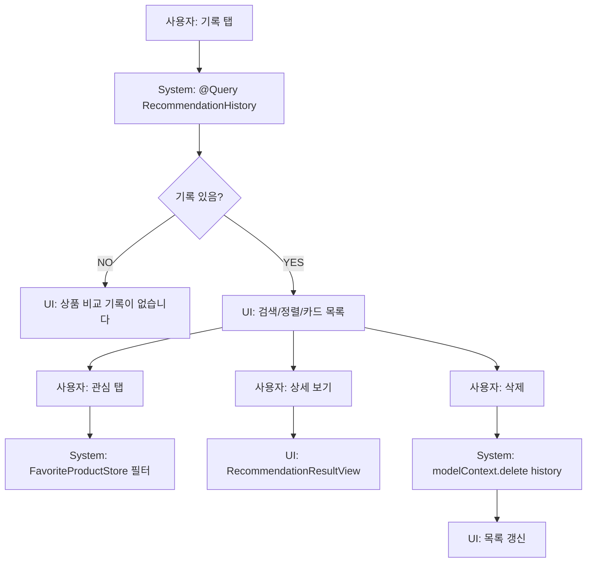

# 14. 기록 흐름

## 2026-10-12 치수 판단 변경

서버 승인 snapshot → VNextRankingEvidence 공통 항목/Decimal 계산 → VNextComparisonEngineAdapter 순위/전체 근거 보존 → 서버 v3 검증 → RecommendationCalculationSnapshot → SizeComparisonDecision → 결과·다른 사이즈·History 표시. 목록도 같은 공통 항목 기준을 사용한다.

핵심 부위가 빠지면 부분 비교와 실제 cm 차이를 표시하고 종합 점수는 숨긴다. 다른 후보에 없는 추가 승인 치수는 additionalMeasurements에 보존한다. 측정법은 접힌 상세에 표시한다. 사용자 선택·서버 권한·보호 스크롤은 그대로 유지한다.

[설계와 배포 순서](../Design/SizeDecision-20261012.md). 실제 개발·운영 DB에는 아직 적용하지 않았다.

## ACT-HISTORY-001 목록 조회

### 시스템 처리
- `RecommendationHistoryView`가 `@Query(sort:\RecommendationHistory.createdAt, order:.reverse)`로 조회.
- favorite 여부는 `FavoriteProductStore` UserDefaults에서 조회.

### 필터/정렬
- 전체/관심 segmented.
- 검색어: 브랜드/상품명.
- 정렬: 최신순, 오래된순, 브랜드순, Fit Confidence순.

## ACT-HISTORY-005 상세 보기

- `HistoryCard`의 `NavigationLink` → `RecommendationResultView(result:)`.

## ACT-HISTORY-006 내 옷장에 추가

- `selectedHistoryForCloset = history`.
- sheet `AddComparedProductToClosetSheet(product:history.product, recommendedSize:history.recommendedSize)`.
- 저장 완료 alert.

## ACT-HISTORY-009 삭제

### 시스템 처리
- `modelContext.delete(history)`.
- `try? modelContext.save()`.

### 예외
- product 관계 삭제 여부는 `RecommendationHistory` 모델 delete rule 명시가 보이지 않으므로 product orphan 가능성 검토 필요.

